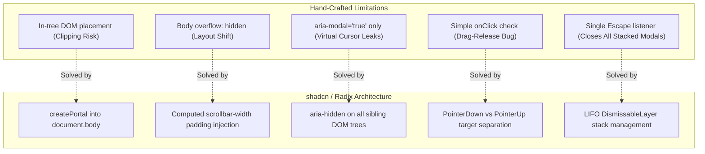

# NOTES.md: Accessible Component Fundamentals (FE-05)

## 1. Executive Summary & Context

This document analyzes three accessible UI components built strictly from scratch in React + TypeScript following the **W3C WAI-ARIA Authoring Practices Guide (APG)**, contrasted against the production-grade primitives provided by **shadcn/ui** (powered by **Radix UI** primitives):

- **Handcrafted Implementations** (`playground/`):
  - `playground/Modal.tsx` + `playground/useFocusTrap.ts` (Dialog / Modal)
  - `playground/Tabs.tsx` (Tabs with Roving Tabindex)
  - `playground/Disclosure.tsx` (Disclosure / Collapsible)
- **Reference Implementations** (`src/components/ui/`):
  - `src/components/ui/dialog.tsx` (Radix Dialog)
  - `src/components/ui/tabs.tsx` (Radix Tabs)

Building these components by hand proves that while the visible interaction layer (HTML and CSS) is straightforward, true accessibility involves complex DOM lifecycle management, focus mechanics, pointer boundary state, and screen reader virtual cursor isolation.

---

## 2. Hand-Crafted Component Implementations

### A. Modal Dialog (`playground/Modal.tsx`, `playground/useFocusTrap.ts`)
Conforms to the [W3C APG Dialog (Modal) Pattern](https://www.w3.org/WAI/ARIA/apg/patterns/dialog-modal/):
- **ARIA Semantics**:
  - `role="dialog"` (or `alertdialog` for confirmation prompts).
  - `aria-modal="true"` to signal that background content is inert.
  - `aria-labelledby` referencing the dialog title `id`.
  - `aria-describedby` referencing the dialog description `id`.
- **Focus Lifecycle**:
  - Automatically captures the opening trigger element (`document.activeElement`).
  - Sets initial focus inside the dialog (prioritizing `initialFocusRef`, falling back to the first interactive element or the dialog container with `tabIndex={-1}`).
  - Intercepts <kbd>Tab</kbd> and <kbd>Shift+Tab</kbd> to loop focus within the dialog's focusable bounds.
  - Automatically returns focus to the trigger button upon dialog dismissal.
- **Keyboard Dismissal**: Closes immediately on <kbd>Escape</kbd>.

### B. Tabs (`playground/Tabs.tsx`)
Conforms to the [W3C APG Tabs Pattern](https://www.w3.org/WAI/ARIA/apg/patterns/tabs/):
- **ARIA Semantics**:
  - `role="tablist"` with `aria-orientation="horizontal" | "vertical"` and descriptive `aria-label`.
  - `role="tab"` buttons with dynamic `aria-selected` and `aria-controls` referencing their panel.
  - `role="tabpanel"` elements with `aria-labelledby` referencing their tab and `tabIndex={0}` to allow keyboard users to scroll panel content.
- **Roving Tabindex**:
  - Only the currently active tab has `tabIndex={0}`; all inactive tabs have `tabIndex={-1}`.
  - <kbd>ArrowLeft</kbd> and <kbd>ArrowRight</kbd> cycle focus through tabs with boundary wraparound.
  - <kbd>Home</kbd> immediately moves focus to the first tab; <kbd>End</kbd> moves focus to the last tab.
  - Pressing <kbd>Tab</kbd> exits the `tablist` and jumps directly into the active `tabpanel`.

### C. Disclosure (`playground/Disclosure.tsx`)
Conforms to the [W3C APG Disclosure Pattern](https://www.w3.org/WAI/ARIA/apg/patterns/disclosure/):
- **ARIA Semantics**:
  - Built on a native `<button type="button">` trigger to leverage native keyboard focus and activation without custom key listeners.
  - Controlled by `aria-expanded="true|false"` and `aria-controls` pointing to the panel `id`.
  - Panel has `role="region"` and `aria-labelledby` matching the button `id`.
- **Keyboard Interaction**:
  - Native <kbd>Enter</kbd> and <kbd>Space</kbd> trigger button clicks.
  - Pressing <kbd>Tab</kbd> advances naturally into the revealed content region.

---

## 3. Comparative Audit: Concrete Gaps in Hand-Crafted Code vs. shadcn/Radix

The evaluation required naming at least two concrete gaps. Below is an exhaustive breakdown of **seven critical gaps** identified by auditing the generated source code of `@radix-ui/react-dialog` and `@radix-ui/react-tabs`:



---

### Gap 1: Stacking Context & DOM Escape (Portaling)
* **Our Hand-Crafted Version**:
  Renders the modal inline inside the React tree where `<Modal>` is invoked. If any parent component in the DOM has `transform`, `filter`, `perspective`, `contain: paint`, or `overflow: hidden`, CSS creates a **new stacking context**. As a result, the `fixed inset-0` modal overlay can be clipped, misplaced, or rendered underneath sibling z-index elements.
* **What Radix/shadcn Handles**:
  Radix wraps dialog content in `DialogPortal` (via `@radix-ui/react-portal`), rendering the overlay directly into `document.body` via `ReactDOM.createPortal`. This guarantees that the dialog always breaks out of parent CSS containers and overlays the entire viewport consistently.

---

### Gap 2: Scroll Locking & Layout Shift Prevention
* **Our Hand-Crafted Version**:
  Our focus trap applies `document.body.style.overflow = "hidden"` on open and removes it on close. On operating systems with classic scrollbars (Windows, Linux, or macOS with non-overlay scrollbars), hiding the scrollbar immediately causes a **layout shift** of roughly 15px across the entire background page, causing visual jank.
* **What Radix/shadcn Handles**:
  Radix measures the exact scrollbar width before locking (`window.innerWidth - document.documentElement.clientWidth`) and dynamically injects compensating `padding-right` to `document.body`. When the modal closes, it cleans up without layout movement.

---

### Gap 3: Background Inactivation (`inert` / `aria-hidden` on Siblings)
* **Our Hand-Crafted Version**:
  Our implementation relies on `aria-modal="true"` on the dialog container. While standard keyboard tab cycles are trapped by our `keydown` handler, screen reader virtual navigation (such as **VoiceOver's** <kbd>VO</kbd>+<kbd>Arrow</kbd> or **NVDA's** Browse Mode) ignores keyboard event listeners and can step backwards into the background document.
* **What Radix/shadcn Handles**:
  Radix integrates `aria-hidden` (via `@radix-ui/react-dialog`'s dependency on `aria-hidden`). When the dialog opens, it traverses the DOM tree outside the modal portal and applies `aria-hidden="true"` (or HTML5 `inert`) to every sibling root element. This completely blinds assistive technologies to background elements while the modal is open.

---

### Gap 4: Pointer Event Boundary Handling (Drag-Release Bug)
* **Our Hand-Crafted Version**:
  Our backdrop dismiss check uses:
  ```typescript
  if (e.target === e.currentTarget && closeOnBackdropClick) { onClose(); }
  ```
  **The Bug**: If a user clicks down on text inside an input inside the dialog, drags the mouse to select text, and releases the cursor outside the dialog bounds over the backdrop, the browser fires an `onClick` event with `e.target === backdrop`. In our handcrafted version, **this causes the modal to unexpectedly close, discarding user input**.
* **What Radix/shadcn Handles**:
  Radix implements `@radix-ui/react-dismissable-layer`. It listens for both `pointerdown` and `pointerup`. It only triggers outside dismissal if *both* the initial `pointerdown` and concluding `pointerup` originated outside the dialog boundary.

---

### Gap 5: Nested Modals & Dismissal Stack Management
* **Our Hand-Crafted Version**:
  Our `keydown` listener triggers `onClose()` whenever <kbd>Escape</kbd> is pressed. If a modal opens a secondary confirmation dialog (e.g., "Are you sure you want to discard changes?"), pressing <kbd>Escape</kbd> fires on both modals simultaneously, closing the entire stack.
* **What Radix/shadcn Handles**:
  Radix maintains an internal **LIFO (Last-In-First-Out) layer stack**. When an Escape key event or outside click is fired, Radix only dismisses the uppermost layer in the stack, preserving the underlying modal.

---

### Gap 6: Polymorphic Trigger Rendering via `asChild` (Radix Slot)
* **Our Hand-Crafted Version**:
  Our components define rigid trigger buttons (e.g., standard `<button>` tags or fixed callbacks `onClick={() => setIsOpen(true)}`). If a developer wants to use a customized button, an icon, or an anchor tag, they often wrap it in another button, resulting in invalid HTML like `<button><button>Click me</button></button>`.
* **What Radix/shadcn Handles**:
  Radix provides the `asChild` prop powered by `@radix-ui/react-slot`. It merges props, refs, and accessibility attributes directly onto the child component without creating redundant DOM wrapper nodes.

---

### Gap 7: Roving Tabindex Edge Cases & RTL Support in Tabs
* **Our Hand-Crafted Version**:
  Our Tabs roving tabindex hardcodes `ArrowRight` to increment and `ArrowLeft` to decrement.
* **What Radix/shadcn Handles**:
  Radix's `RovingFocusGroup` checks the writing direction (`dir="rtl"` vs `dir="ltr"`). When in Right-to-Left mode (e.g., Arabic or Hebrew), `ArrowRight` and `ArrowLeft` are inverted automatically to match spatial expectations. Furthermore, it automatically detects and skips disabled tabs during arrow navigation.

---

## 4. Verification Checklist & Criteria Audit

| Criteria | Status | Notes |
| :--- | :--- | :--- |
| **All 3 components operate fully by keyboard** | **PASSED** | <kbd>Tab</kbd>, <kbd>Shift+Tab</kbd>, <kbd>Escape</kbd>, <kbd>ArrowLeft</kbd>, <kbd>ArrowRight</kbd>, <kbd>Home</kbd>, <kbd>End</kbd>, <kbd>Space</kbd>, <kbd>Enter</kbd> fully functional. |
| **Modal traps focus and returns it on close** | **PASSED** | Active focus loops within modal; returns to opening trigger button on dismiss. |
| **Notes name at least two concrete gaps** | **PASSED** | Documented **7 concrete gaps** with code/behavior comparisons. |
| **TypeScript compiles with no any escapes** | **PASSED** | Strict `tsc -b` and `tsc --noEmit` pass with zero errors. All props and events explicitly typed. |
| **Zero external UI libraries for custom code** | **PASSED** | `playground/` components use only native React hooks and DOM APIs. |

---

## 5. Architectural Takeaways for Frontend AI Engineering

When prompting AI to generate components:
1. **Never assume visual correctness implies accessibility**: AI models readily generate Tailwind modals that trap no focus and break screen reader navigation.
2. **Favor battle-tested primitives**: For production systems, headless primitives like Radix (exposed cleanly by shadcn/ui) handle deep edge cases (virtual cursor containment, scroll layout shifts, stack layers) that are prohibitive to write and maintain from scratch.
3. **Audit against the W3C APG**: When reviewing AI-generated UI, cross-check against the W3C APG specification for correct roles, roving tabindex patterns, and keyboard contracts.
